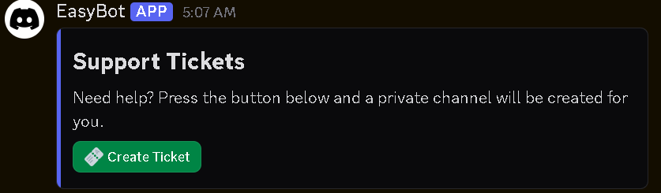
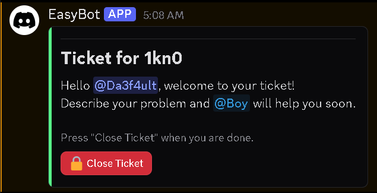

# Ticket System Components V2

This example adds a support ticket system built with Components V2. An admin posts a ticket panel with the `!ticket-setup` command. Members press the **Create Ticket** button to get a private channel visible only to them and your support staff. Each ticket includes a welcome card with a **Close Ticket** button, which only support staff can use. Each member can have only one open ticket at a time.

## Preview

## Setup

In `index.js`, replace `ADMIN_ROLE_ID`, `SUPPORT_ROLE_ID`, and `CATEGORY_ID` with the IDs from your server. `ADMIN_ROLE_ID` is the role allowed to post the ticket panel, `SUPPORT_ROLE_ID` is the staff role that can see and close tickets, and `CATEGORY_ID` is the category where ticket channels are created (leave it as `''` to create them without a category).

Make sure the bot has the **Manage Channels** permission, then type `!ticket-setup` in the channel where you want the panel to appear.